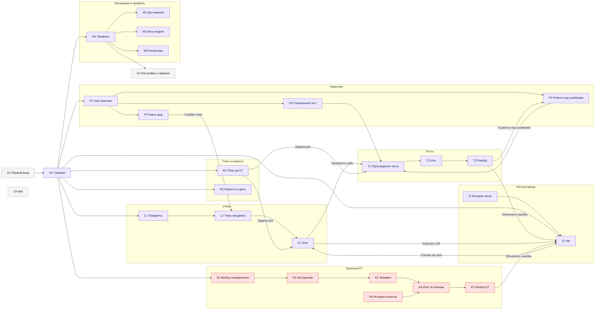
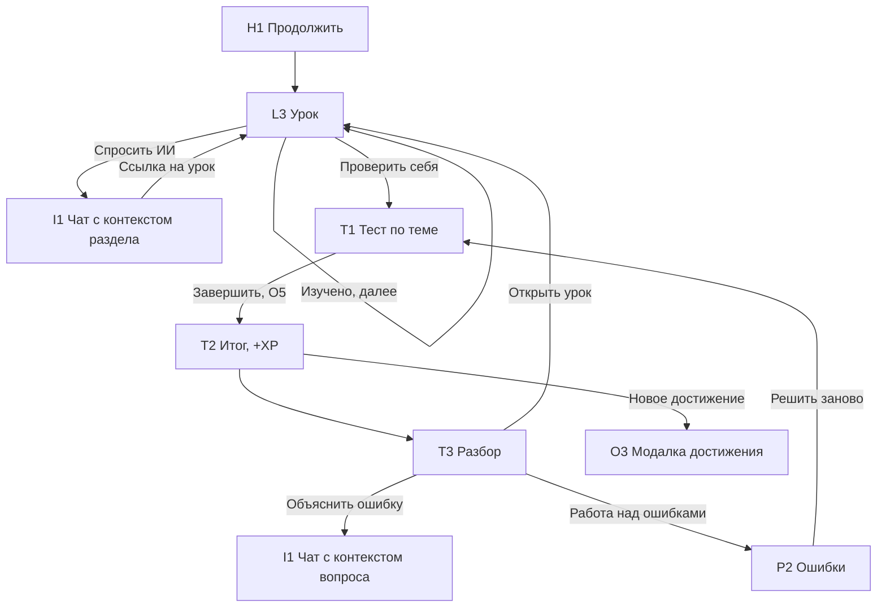
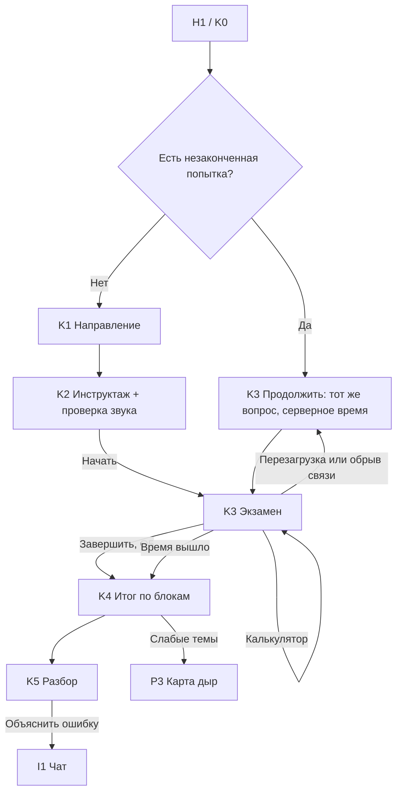
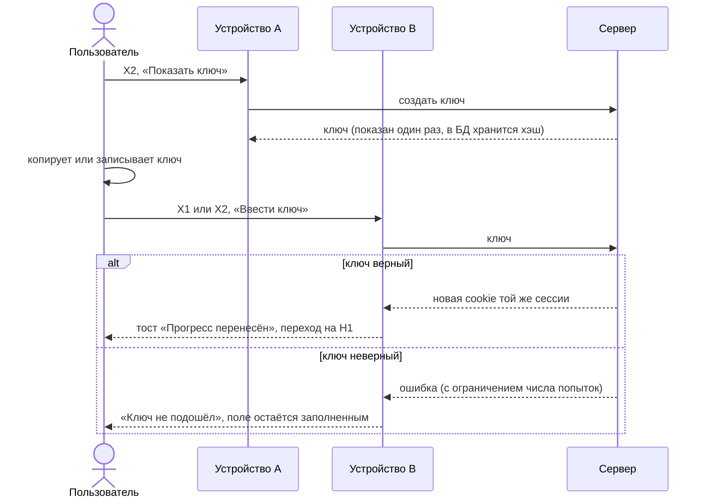
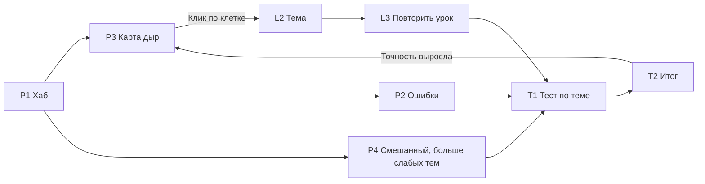
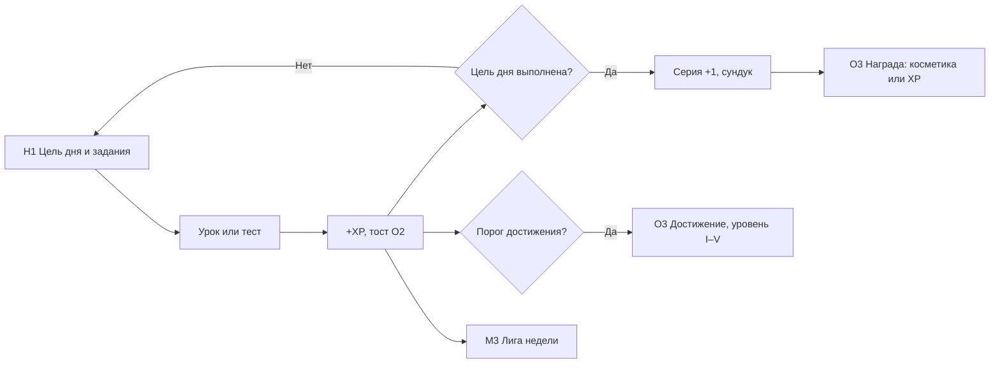
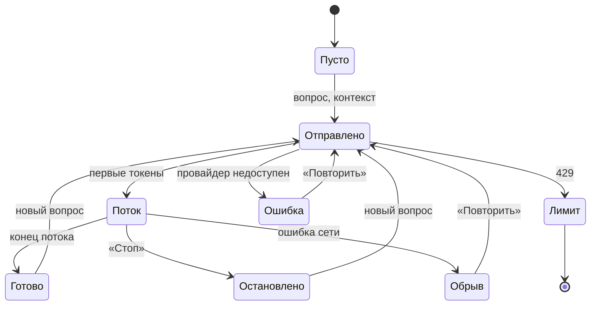

# A-01. Карта экранов и сценарии

Исходник для страницы **«Карта сайта»** в Figma (issue #1). Здесь перечислены все экраны,
переходы между ними и ключевые сценарии. Следующие задачи опираются на этот документ:
вайрфреймы (A-02), роутер (E-01) и API-контракт (B-01).

> Пути (`/learn/...`) — это предложение для E-01 и B-01. Если в коде их поменяют,
> меняем и этот файл в том же PR.

## Принципы

1. **Без регистрации.** Прогресс привязан к cookie-сессии. На другое устройство его
   переносят **ключом восстановления** (B-03).
2. **Цикл обучения.** Урок → тест → разбор → работа над ошибками. С любого экрана
   до следующего шага цикла — один клик.
3. **ИИ работает в контексте.** «Спросить ИИ» на уроке и «Объяснить ошибку» в разборе
   открывают чат, в котором уже есть контекст (раздел или вопрос).
4. **Пробный КТ — отдельный режим.** Нет навигации по сайту, ИИ и подсказок. Таймер
   идёт на сервере. После перезагрузки страницы попытка продолжается.
5. **У каждого экрана четыре состояния:** загрузка (скелетон), пусто, ошибка, данные.
   Их рисуем в A-02, ниже они перечислены, если у экрана есть что-то особенное.

## Предметы

| Код | Предмет | Откуда контент |
|-----|---------|----------------|
| `eng` | Английский язык | генератор, S-07 |
| `tgo` | ТГО (тест на готовность к обучению) | генератор, S-07 |
| `algo` | Алгоритмы (профиль) | импорт, S-04 |
| `db` | Базы данных (профиль) | импорт, S-04 |

Состав блоков КТ, число заданий, время и пороги задаёт `content/exam_config.json` (S-08).
В макетах эти числа не зашиваем, а берём из конфига.

## Карта сайта

### Глобальные слои (поверх любого экрана)

| Код | Слой | Как вызвать | Задачи |
|-----|------|-------------|--------|
| O1 | Поиск по разделам | `Ctrl+K` / `⌘K`, иконка лупы | A-06, E-06, B-05 |
| O2 | Тост-уведомление (XP, достижение, ошибка сети) | событие | A-04, B-10 |
| O3 | Модалка «Новое достижение» (+ сундук) | событие | A-11, B-10 |
| O4 | Модалка «Ключ восстановления» | X2, X1 | A-04, B-03 |
| O5 | Подтверждение («Завершить тест?», «Выйти из КТ?») | действие | A-04 |
| O6 | Калькулятор | кнопка в K3 (только для блоков с калькулятором) | A-09, E-10 |

Внутри пробного КТ (K3) работают только O5 и O6. Поиск, ИИ и тосты о наградах там
**выключены**, а награды показываем уже на итоге (K4).

## Навигация

| | Десктоп (≥ 1024 px) | Мобильный (360–767 px) |
|---|---|---|
| Основная | Левая колонка: Главная, Учёба, Практика, Пробный КТ, ИИ, План | Нижние вкладки: Главная, Учёба, Практика, ИИ, Профиль (E-15) |
| Вторичная | Шапка: поиск, серия 🔥, XP, аватар → профиль | Шапка: поиск, серия; КТ и План доступны с главной |
| Урок | Оглавление слева, текст по центру, «Спросить ИИ» справа | Оглавление в выдвижной панели, свайп ←/→ между разделами |
| Пробный КТ | Полноэкранный режим без колонок | Полноэкранный режим, сетка заданий в нижнем листе |

Планшет (768–1023 px) — левая колонка сворачивается до иконок.

## Экраны

Обозначения: **Путь** — адрес в роутере, **Данные** — ресурс API (уточнит B-01).

### X — Системные

**X1. Первый вход** — `/welcome` (показывается один раз, пока у сессии нет настроек)
- 3 шага: «Что такое ExamPrep» → «Когда КТ?» (дата или «не знаю») → «Уже занимался
  на другом устройстве? Ввести ключ».
- Пропустить можно в любой момент: тогда дата КТ берётся из N2, ключ можно ввести в X2.
- Задачи: A-02, E-01, B-03.

**X2. Настройки и перенос** — `/settings`
- Тема (светлая / тёмная / системная), акцент (8 цветов), узор фона (8 штук), режим фокуса по умолчанию.
- Ключ восстановления: «Показать ключ» (один раз, с копированием), «Ввести ключ с другого устройства».
- Дата КТ и цель дня (в минутах или XP).
- Сброс прогресса (с подтверждением O5).
- Задачи: A-11, E-03, B-03, B-09.

**X3. 404** — любой неизвестный путь. Кнопки «На главную» и «Поиск».

### H — Главная

**H1. Главная** — `/`
- «Продолжить»: последний урок, тест или незаконченный пробный КТ (у КТ высший приоритет).
- Обратный отсчёт до КТ, ссылка на N2.
- Цель дня (кольцо прогресса), серия, задания дня, сундук.
- Задача дня из плана (N1).
- Прогресс по 4 предметам (полоска «изучено», доля верных ответов).
- Пусто (первый день): вместо «Продолжить» показываем «Начать с …» и рекомендованную тему.
- Данные: `GET /me`, `/me/progress`, `/plan/today`, `/kt/attempts?active`.
- Задачи: A-02, A-11, A-12, E-13, E-14.

### L — Учёба

**L1. Предметы** — `/learn`
- 4 карточки предметов: прогресс, сколько тем изучено, точность по тестам.

**L2. Темы предмета** — `/learn/:subject`
- Список тем с разделами, статусы: не начато / в процессе / изучено / «дыра» (точность ниже порога).
- Кнопки: «Тест по теме» (T1), «Продолжить».

**L3. Урок** — `/learn/:subject/:topic/:section`
- Оглавление темы, Markdown-текст, код с вкладками (например, C++ / Python / Java),
  таблицы.
- Кнопка «Изучено», переходы ←/→ (клавиатура и свайп), режим фокуса (без колонок).
- «Спросить ИИ»: выделенный текст и раздел уходят в контекст I1.
- В конце темы: «Проверить себя» → T1 с этой темой.
- Задачи: A-05, A-06, E-05, B-05.

### T — Тесты

**T1. Прохождение теста** — `/test/:attemptId`
- Типы вопросов: один ответ, несколько ответов, вопрос с кодом, группа вопросов
  с **общим материалом** (текст или таблица слева, вопросы справа).
- Прогресс-бар, навигация по вопросам, «Завершить».
- Режимы запуска: тест по теме (из L2/L3), работа над ошибками (P2), смешанный (P4).
  Экран один, отличается только заголовок.
- Ответ сохраняется сразу (оффлайн → тост «Не сохранено, повторяем…»).
- Задачи: A-05, A-07, E-07, B-06.

**T2. Итог теста** — `/test/:attemptId/result`
- Баллы, точность, время, начисленные XP (+ анимация уровня и достижения через O3).
- Кнопки: «Разбор», «Повторить тему», «Работа над ошибками».

**T3. Разбор** — `/test/:attemptId/review`
- Каждый вопрос: ваш ответ, верный ответ, пояснение. Фильтр «Только ошибки».
- «Объяснить ошибку» открывает I1 с вопросом и ответом (B-14 кэширует ответы).
- «Открыть урок» ведёт в раздел L3, где разбирается эта тема.

### P — Практика

**P1. Хаб практики** — `/practice`
- 3 карточки: ошибки (счётчик), карта дыр (число слабых тем), смешанный тест.

**P2. Работа над ошибками** — `/practice/mistakes`
- Список вопросов, на которые ответили неверно, сгруппированный по предметам и темам.
- «Решить заново» → T1. После 2 верных ответов подряд вопрос уходит из списка
  (правило уточнит B-07).
- Пусто: «Ошибок нет 🎉» + кнопка смешанного теста.

**P3. Карта дыр** — `/practice/gaps`
- Тепловая карта «предмет × тема» по точности, легенда, клик по клетке → L2 / T1.
- Пусто: «Мало данных — пройдите хотя бы по одному тесту в каждом предмете».

**P4. Смешанный тест** — `/practice/mixed`
- Настройки: предметы, число вопросов, «больше слабых тем». «Начать» → T1.
- Задачи блока P: A-08, E-08, B-07.

### K — Пробный КТ

**K0. История попыток** — `/kt`
- Список попыток: дата, направление, баллы, «прошёл порог / нет». Кнопка «Новая попытка».
- Если есть незаконченная попытка — баннер «Продолжить» сверху.

**K1. Выбор направления** — `/kt/new`
- Направления и их блоки из `exam_config.json` (S-08). Для каждого показываем
  состав блоков, число заданий, время и пороги.

**K2. Инструктаж** — `/kt/new/:direction`
- Правила: таймер идёт на сервере, ответы можно менять, аудио — не больше 2 прослушиваний,
  калькулятор только в разрешённых блоках, ИИ и поиск отключены.
- Проверка звука (короткий тест Web Speech). «Начать» создаёт попытку.

**K3. Экзамен** — `/kt/:attemptId`
- Шапка: блок, таймер (предупреждения на 10 и 1 минуте), «Завершить».
- Сетка заданий: отвечено / не отвечено / отмечено «вернуться».
- Задание: вопрос, варианты, флажок «вернуться», для аудирования — плеер
  с счётчиком «осталось прослушиваний: N».
- Калькулятор O6 (если блок разрешает).
- Состояния: потеря связи (ответы копятся в очереди, баннер), время вышло
  (автозавершение → K4), перезагрузка страницы (продолжаем с того же места и времени).
- Задачи: A-09, E-09, E-10, E-11, B-08.

**K4. Итог по блокам** — `/kt/:attemptId/result`
- Сумма баллов, баллы по каждому блоку относительно порога, итог «прошёл / не прошёл»,
  сравнение с прошлой попыткой.
- Кнопки: «Разбор», «Слабые темы → P3», «Новая попытка».

**K5. Разбор КТ** — `/kt/:attemptId/review`
- Как T3, но с группировкой по блокам. Аудио повторно прослушать можно (лимита нет).

### I — ИИ-наставник

**I1. Чат** — `/ai` и `/ai/:chatId`
- Ответ приходит потоком (SSE), кнопка «Стоп», «Повторить».
- Карточка контекста над полем ввода: «Раздел: …» или «Вопрос №…»; её можно убрать.
- Ссылки на уроки в ответах — это кликабельные чипы, ведут в L3.
- Ошибки: лимит исчерпан (сколько осталось и когда сбросится), провайдер недоступен,
  обрыв потока («Ответ прерван — продолжить?»).
- На мобильном I1 открывается из урока как нижний лист, а не отдельная страница.

**I2. История чатов** — `/ai/history` (на десктопе — левая колонка I1)
- Список чатов по датам, переименование, удаление.
- Задачи блока I: A-10, E-12, B-13, B-14.

### M — Мотивация и профиль

**M1. Профиль** — `/me`
- Аватар (рамка и акцент из косметики), уровень и XP до следующего, серия, рекорд серии.
- Графики: XP по дням (14 дней), точность по предметам, время занятий.
- Ссылки: M2, M3, M4, X2.

**M2. Достижения** — `/me/achievements`
- Сетка достижений, у каждого уровни I–V и прогресс до следующего уровня.
- Скрытые достижения показываем силуэтом «???», пока они не получены.

**M3. Лига недели** — `/league`
- Рейтинг по XP за неделю, своя строка закреплена, сколько осталось до конца недели,
  зоны повышения и понижения. Данные обновляются раз в минуту.

**M4. Косметика** — `/me/cosmetics`
- Акценты, узоры фона, рамки аватара. Открыто / закрыто (и чем открывается).
  Просмотр перед применением.
- Задачи блока M: A-11, E-13, B-09, B-10, B-11.

### N — План и новости

**N1. План до КТ** — `/plan`
- Календарь или лента по неделям до даты КТ, задача на каждый день (урок, тест, повторение
  слабой темы), отметки «сделано», пересчёт при пропуске.
- Пусто (не указана дата КТ): форма выбора даты.
- Задачи: A-12, E-14, B-12.

**N2. Новости и даты** — `/news`
- Большой обратный отсчёт до ближайшей даты КТ, ключевые даты (регистрация, КТ, результаты).
- Лента новостей; у каждой новости есть ссылка на официальный источник (S-09).
- Задачи: A-12, E-14, B-15.

## Сценарии

### С1. Урок → тест → разбор (основной цикл)

**Критерии:** от главной до первого вопроса теста — не больше 3 кликов. Из разбора можно
спросить ИИ о конкретной ошибке без повторного ввода вопроса.

### С2. Пробный КТ

**Критерии:** таймер на клиенте только показывает время, истина на сервере (B-08).
Перезагрузка страницы не сбрасывает ни время, ни ответы. Награды и тосты показываются
только на K4.

### С3. Перенос прогресса ключом

**Критерии:** ключ виден только один раз, а потом его можно перевыпустить. Предупреждение:
«Без ключа прогресс пропадёт при очистке браузера». Если у устройства B уже есть свой
прогресс, перед заменой спрашиваем подтверждение (O5).

### С4. Практика: от слабой темы к результату

### С5. Ежедневная мотивация

### С6. ИИ-наставник

## Как собрать страницу «Карта сайта» в Figma

1. Страница `00 Карта сайта`. Слева легенда цветов: учёба — фиолетовый, пробный КТ — красный,
   системные и слои — серый пунктир.
2. На каждый экран — карточка 240 × 160 с **кодом и названием** (`L3 Урок`), путём и
   списком задач. Коды в Figma, в коде и в issues одинаковые.
3. Колонки слева направо: X, H, L, T, P, K, I, M, N. Глобальные слои O1–O6 — отдельной
   строкой внизу.
4. Стрелки (коннекторы FigJam или плагин Autoflow) — только переходы из этого документа,
   с подписью действия («Проверить себя»).
5. Сценарии С1–С6 — отдельные секции под картой, по одной ленте на сценарий.

## Открытые вопросы (решить на созвоне перед A-02)

1. Состав направлений и блоков КТ, время, пороги — ждём S-08. Сейчас макет K1–K4 рисуем
   на 4 блока с переменными числами.
2. Нужна ли регистрация хотя бы по желанию? Сейчас — нет, только ключ (B-03).
3. Где на мобильном пробный КТ и план: на главной (как сейчас) или 6-я вкладка?
4. Лимит ИИ-запросов в день — число нужно для текста ошибки в I1 (B-14).
5. Сколько верных ответов подряд убирает вопрос из «Работы над ошибками» (B-07)?

## Ссылки

- Figma (FigJam): https://www.figma.com/board/M0PJVLvnZEm2Y1IztEerD9 (карта сайта и сценарии С1–С6)
- Задачи: A-02 (вайрфреймы), E-01 (роутер), B-01 (API-контракт)
