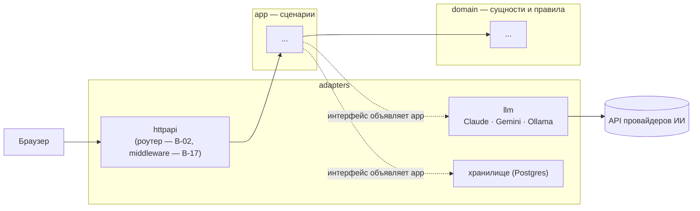

# Архитектура

Сайт подготовки к КТ в магистратуру: Go-бэкенд и фронтенд без сборки. Документ обновляется вместе с кодом.

## Схема

## Слои

Зависимости направлены внутрь: adapters → app → domain.

| Слой | Пакеты | Ответственность |
|---|---|---|
| domain | `internal/domain/...` | сущности и правила предметной области, без I/O |
| app | `internal/app/...` | сценарии; объявляет маленькие интерфейсы того, что ему нужно снаружи |
| adapters | `internal/adapters/llm` | потоковые ответы языковых моделей: Claude, Gemini, Ollama (B-13) |
| | `internal/adapters/httpapi/...` | HTTP: роутер и сервер (B-02), защитные middleware (B-17) |
| | хранилище | будет в S-03 |
| запуск | `cmd/...` | сборка зависимостей через конструкторы, конфиг — будет в B-02 |

## Поток запроса

Будет в B-02.

## Где данные

Будет в S-03.

## Ключевые решения

- **LLM через стандартную библиотеку, без SDK.** Три протокола (SSE Anthropic, SSE Gemini, NDJSON Ollama) —
  это сотня строк разбора; SDK добавил бы зависимости и разные модели ошибок. Адрес и `*http.Client`
  передаются в конструктор, поэтому адаптеры тестируются на `httptest.Server`.
- **Интерфейс провайдера объявляет потребитель (B-14).** Пакет `llm` экспортирует конкретные типы
  `Claude`, `Gemini`, `Ollama` с методом `Stream(ctx, Request) iter.Seq2[string, error]`; общий интерфейс
  появится там, где его используют.
- **Защитные заголовки — middleware.** CSP, проверка Origin и лимит тела запроса оборачивают весь роутер,
  поэтому действуют на каждом ответе и не зависят от того, не забыл ли их отдельный обработчик.
