# База данных

Postgres 18. Схема — SQL-миграции goose в `migrations/` (S-03), встроены в бинарник сервера. Источник полей — контракт
`api/openapi.yaml` и задачи B-04…B-15. Документ обновляется вместе с миграциями.

## Миграции

| Команда | Что делает |
|---|---|
| `make migrate-up` | применить новые миграции к локальной базе (`make up` до этого) |
| `make migrate-down` | откатить последнюю миграцию |
| `make migrate-status` | какие миграции применены |
| `server migrate up\|down\|status` | то же без make; база — из `DATABASE_URL` |
| `docker compose run --rm app migrate up` | то же из образа сервера (в нём нет оболочки, только бинарник) |

- Файл — `NNNNN_имя.sql` с разделами `-- +goose Up` и `-- +goose Down`; goose выполняет каждый в транзакции и записывает
  версию в `goose_db_version`.
- **Применённую миграцию не правим.** Изменение схемы — новый файл со следующим номером и честным `Down`.
- Тест `migrations/migrations_test.go` (нужен `TEST_DATABASE_URL`, в CI он есть) создаёт пустую схему, применяет все
  миграции, откатывает до нуля (не должно остаться ни таблиц, ни доменов), применяет снова и проверяет ключевые ограничения.
  Схема теста удаляется, поэтому его можно гонять на общей базе.
- Сервер сам миграции при запуске пока не применяет: базу он начнёт использовать в B-04, тогда и решим (подкоманда перед
  стартом в деплое S-13 или вызов `Up` при запуске). Одновременный запуск защищён блокировкой в базе (advisory lock).

## ER-схема

Таблицы пользователя ссылаются на `sessions` (на схеме это одна связь на группу, чтобы не загромождать).

```mermaid
erDiagram
    sessions ||--o{ session_tokens : "токены браузеров"
    sessions ||--o| progress : "XP и серия"
    sessions ||--o{ xp_daily : "по дням"
    sessions ||--o{ section_marks : "Изучено"
    sessions ||--o{ question_progress : "ответы по вопросам"
    sessions ||--o{ test_attempts : "тесты"
    sessions ||--o{ kt_attempts : "пробный КТ"
    sessions ||--o{ daily_tasks : "задания дня"
    sessions ||--o{ daily_chests : "сундук"
    sessions ||--o{ achievements : "достижения"
    sessions ||--o{ cosmetic_unlocks : "косметика"
    sessions ||--o{ notifications : "уведомления"
    sessions ||--o{ plan_tasks : "план до КТ"
    sessions ||--o{ ai_chats : "чаты"
    sessions ||--o{ ai_usage_daily : "лимит ИИ"

    topics ||--o{ sections : ""
    topics ||--o{ questions : ""
    sections |o--o{ questions : "урок к вопросу"
    shared_materials |o--o{ questions : "общий текст"
    questions ||--|{ question_options : "варианты"

    sections ||--o{ section_marks : ""
    questions ||--o{ question_progress : ""
    test_attempts ||--|{ test_questions : ""
    questions ||--o{ test_questions : ""
    kt_attempts ||--|{ kt_tasks : ""
    questions ||--o{ kt_tasks : ""
    ai_chats ||--o{ ai_messages : ""
    questions ||--o{ ai_explanations : "кэш"

    sessions {
        text id PK
        text display_name
        bytea recovery_key_hash UK "SHA-256, null — ключа нет"
        timestamptz recovery_issued_at
        boolean onboarded
        text theme "light, dark, system"
        text accent
        text pattern
        text avatar_frame
        date exam_date
        text daily_goal_type "minutes, xp"
        int daily_goal_value "5..600"
    }
    session_tokens {
        bytea token_hash PK "SHA-256"
        text session_id FK
        timestamptz last_seen_at
    }
    topics {
        bigint id PK
        text ext_id UK
        subject_code subject
        int position
        text sum_hash
    }
    sections {
        bigint id PK
        text ext_id UK
        bigint topic_id FK
        int position
        text body_md
        text sum_hash
    }
    shared_materials {
        bigint id PK
        text ext_id UK
        text body_md
    }
    questions {
        bigint id PK
        text ext_id UK
        subject_code subject
        bigint topic_id FK "null у английского и ТГО"
        text kind "single, multiple"
        bigint shared_material_id FK
        bigint section_id FK
        text listen_text
        text sum_hash
    }
    question_options {
        bigint question_id PK, FK
        text ext_id PK
        smallint position
        boolean is_correct
    }
    section_marks {
        text session_id PK, FK
        bigint section_id PK, FK
        boolean studied
        timestamptz first_studied_at
    }
    test_attempts {
        uuid id PK
        text session_id FK
        text mode "topic, mistakes, mixed"
        bigint topic_id FK
        text status "active, finished"
        int correct
        int xp_awarded
    }
    test_questions {
        uuid attempt_id PK, FK
        smallint position PK
        bigint question_id FK
        text[] selected
        boolean is_correct
    }
    question_progress {
        text session_id PK, FK
        bigint question_id PK, FK
        int answered
        int correct
        int correct_streak
    }
    kt_attempts {
        uuid id PK
        text session_id FK
        text track "research, profile"
        text status "active, finished, expired"
        timestamptz deadline_at "серверный таймер"
        int total
        boolean passed
    }
    kt_tasks {
        uuid attempt_id PK, FK
        smallint position PK
        subject_code block
        bigint question_id FK
        text[] selected
        boolean flagged
        smallint plays
        smallint points
    }
    progress {
        text session_id PK, FK
        bigint xp
        int streak_days
        int best_streak
        date last_active_on
    }
    xp_daily {
        text session_id PK, FK
        date day PK
        int xp
        int minutes
    }
    daily_tasks {
        text session_id PK, FK
        date day PK
        smallint position PK
        text kind
        int target
        int progress
    }
    daily_chests {
        text session_id PK, FK
        date day PK
        int xp
        text cosmetic_id
    }
    achievements {
        text session_id PK, FK
        text achievement_id PK
        smallint level "1..5"
    }
    cosmetic_unlocks {
        text session_id PK, FK
        text cosmetic_id PK
    }
    notifications {
        uuid id PK
        text session_id FK
        text type "xp, level_up, achievement, chest_ready, cosmetic_unlocked"
        timestamptz seen_at
    }
    plan_tasks {
        uuid id PK
        text session_id FK
        date day
        text kind "lesson, test, review, kt"
        text ref_type
        text ref_id
        timestamptz done_at
    }
    ai_chats {
        uuid id PK
        text session_id FK
        text title
        text context_type "section, question"
        text context_id
        timestamptz updated_at
    }
    ai_messages {
        uuid id PK
        uuid chat_id FK
        text role "user, assistant"
        text text_md
        boolean interrupted
    }
    ai_usage_daily {
        text session_id PK, FK
        date day PK
        int requests
    }
    ai_explanations {
        bigint question_id PK, FK
        text question_sum_hash PK
        text[] selected PK
        text text_md
    }
```

## Таблицы

| Миграция | Таблица | Что хранит | Задача |
|---|---|---|---|
| 00001 | `sessions` | анонимный пользователь: ник, хэш ключа восстановления, настройки (`/api/me/settings`) | B-03, B-04 |
| | `session_tokens` | хэши токенов cookie `sid`, по одному на браузер; `last_seen_at` для срока жизни и очистки | B-03, B-04 |
| 00002 | `topics`, `sections` | темы и разделы (уроки) по порядку `position` | S-05, B-05 |
| | `shared_materials` | общий текст или таблица к группе вопросов | S-05, B-06 |
| | `questions`, `question_options` | вопросы с вариантами, пояснением, ссылкой на урок и текстом аудирования | S-05, B-06, B-08 |
| 00003 | `section_marks` | отметки «Изучено»; строка остаётся после снятия отметки, чтобы XP не начислялся повторно | B-05 |
| | `test_attempts`, `test_questions` | тесты по теме, по ошибкам и смешанные: вопросы в порядке показа, выбранные ответы, итог | B-06 |
| | `question_progress` | ответов и верных по вопросу, серия верных подряд: список ошибок и «карта дыр» | B-07 |
| 00004 | `kt_attempts`, `kt_tasks` | пробный КТ: вариант, срок `deadline_at`, ответы, «вернуться», прослушивания, баллы | B-08 |
| 00005 | `progress` | XP, текущая и лучшая серия | B-09 |
| | `xp_daily` | XP и минуты по дням: графики, цель дня, лига недели | B-09, B-11 |
| | `daily_tasks`, `daily_chests` | задания дня и открытый сундук | B-09 |
| | `achievements`, `cosmetic_unlocks` | полученные уровни достижений I–V и открытая косметика | B-10 |
| | `notifications` | непоказанные награды для тостов и окна достижения | B-10 |
| 00006 | `plan_tasks` | план до КТ по дням | B-12 |
| 00007 | `ai_chats`, `ai_messages` | история чатов с ИИ-наставником | B-14 |
| | `ai_usage_daily` | запросов к модели за сутки (лимит) | B-14 |
| | `ai_explanations` | кэш «Объяснить ошибку», общий для всех пользователей | B-14 |

`session.Store` из B-03 ложится на первые две таблицы без изменений порта: `CreateSession` — две вставки в одной транзакции,
`SessionByToken` — соединение с `session_tokens` (отдаёт `last_seen_at` как `TokenLastSeen`), `SetRecoveryKey` — обновление
двух полей (новый ключ затирает старый), `DeleteExpired` — удаление старых токенов и сессий без токенов; всё остальное
пользователя уходит каскадом.

## Ключевые решения

- **goose, а не golang-migrate.** Up и Down в одном файле читаются вместе, миграции встраиваются через `embed.FS`, у
  `goose.Provider` нет глобального состояния (провайдер на тест), есть блокировка от двойного запуска. Версия v3.27 — последняя,
  которой хватает Go 1.25 из `go.mod`.
- **Применяет сам сервер (`server migrate …`), а не отдельный `cmd/migrate`.** В образе distroless один бинарник; миграции
  едут вместе с кодом, который на них рассчитан, и версии не разъезжаются.
- **Сессия — это пользователь.** Регистрации нет, поэтому настройки — колонки `sessions` (1:1, без лишнего соединения).
  Сброс прогресса (`DELETE /api/me/progress`) удаляет строки пользователя во всех таблицах, кроме `sessions` и
  `session_tokens`: настройки и ключ сохраняются.
- **Удаление сессии уносит всё (`on delete cascade`).** Очистке (`DeleteExpired`) достаточно удалить строки `sessions`.
- **Контент: внутренний `bigint`, наружу `ext_id`.** Загрузчик (S-05) делает upsert по `ext_id` и пропускает строки с прежним
  `sum_hash`; на `bigint` ссылается прогресс пользователей. В API идентификаторы — `ext_id`.
- **Контент из истории не удаляется (`on delete restrict`).** Вопрос, который был в тесте или пробном КТ, удалить нельзя,
  иначе изменились бы итоги прошлых попыток. Ошибки (`question_progress`), отметки «Изучено» и кэш объяснений к удалённому
  контенту не нужны — там `cascade`. Ссылка вопроса на урок — `set null`.
- **Предметы — домен `subject_code`,** а не таблица: их четыре, коды фиксированы контрактом, названия — в
  `content/exam_config.json`. Составные внешние ключи проверяют, что предмет вопроса совпадает с предметом темы, а блок
  задания КТ — с предметом вопроса.
- **Каталоги — в коде.** Достижения, задания дня, косметика и формат КТ описаны в коде и `content/*.json`; в базе только их коды
  (`achievement_id`, `cosmetic_id`, `kind`). Новое достижение не требует миграции.
- **Перечисления — `text` + `check`,** а не `enum`: значение проще добавить новой миграцией, и оно читается в `psql` как есть.
- **Идентификаторы пользовательских объектов — `uuidv7()`** (встроена в Postgres 18): не перебираются подряд, как `serial`,
  и упорядочены по времени, поэтому индексы не фрагментируются. В API — непрозрачные строки.
- **Хэши токена и ключа — `bytea` ровно 32 байта** (`session.TokenHash`, `session.KeyHash`), длину проверяет `check`.
- **Итог теста и КТ хранится полями** (`correct`, `xp_awarded`, `total`, `passed`…), их наличие связано со статусом `check`.
  «Не больше одной незавершённой попытки» — частичные уникальные индексы (`where status = 'active'`), а не проверка в коде.
- **Не в базе.** Новости и даты КТ — `content/news.json` (B-15 отдаёт файл). Формат КТ — `content/exam_config.json`. Лига недели
  считается из `xp_daily` (индекс по `day`), отдельных таблиц у неё нет. Уровень — формула от `progress.xp`.

## Открытые вопросы (к B-04…B-14)

- **Формат `sum_hash`** пока `text`: какой хэш и от чего считается, решит загрузчик S-05.
- **Поиск (B-05).** Индекса полнотекстового поиска нет: IDF по нескольким сотням разделов дешевле считать в памяти. Если нужен
  поиск в базе — `tsvector` и GIN-индекс отдельной миграцией.
- **Какие ответы считаются в «карту дыр» и ошибки** — только тесты или ещё пробный КТ; схема подходит для обоих.
- **Границы суток** для `xp_daily`, `daily_tasks`, `ai_usage_daily` и серии — UTC или время Казахстана; приложение передаёт `day`
  явно, база не решает за него.
- **Пустые сессии (#93).** Если `DeleteUnused` будет искать сессии по `created_at`, понадобится индекс `sessions (created_at)`.
- **Лиги с повышением и понижением (B-11, урезано)** потребуют хранить лигу пользователя — колонкой в `progress`.
